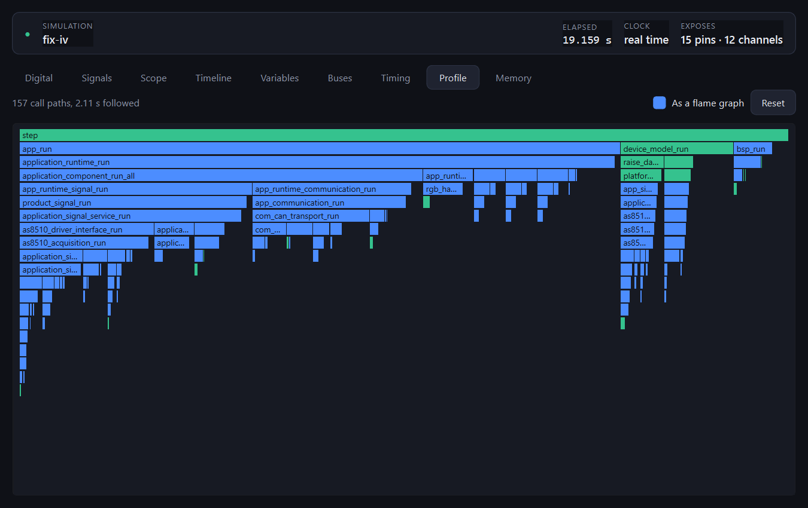

# Checking a simulation

Five ways to find out what a simulation is really doing, from the cheapest
to the most thorough:

| What | When it runs | What it answers |
| --- | --- | --- |
| [`looper-cli audit`](#auditing-before-anything-runs) | before a build | does anything stand behind each call |
| [The timing page](#what-every-call-costs) | while it runs | what one call of anything costs, and which calls are hollow |
| [The profile page](#where-the-whole-simulation-spends-its-time) | while it runs | where the second went, as shares that add up |
| [The memory page](#where-the-memory-goes) | a build, and a run | what it holds statically, on the stack and on the heap |
| [`looper.testing`](#expecting-things-of-a-run) | in `pytest` | did the firmware do what it should |

This page describes each tool and how it works. For the other way round --
a question you have, the tool that answers it, and what the answer does and
does not mean -- see [Analysing a firmware](analysing.md).

They overlap on purpose. A simulation that compiles, starts and runs quietly
can still be wrong in one specific way: an adapter function nothing
implements returns the zero value, and the firmware believes it. The audit,
the timing page and the expectations each catch that at a different moment.
The profile page answers a different question -- not whether the simulation
is honest, but where its second went.

## What every call costs

Two instruments fill this page, and a function appears from whichever one
measured it. Every generated adapter function is timed on the host around
the call to whatever answers it -- that is the journal, there whenever
`record_calls` is left at its default. Everything else, the firmware and the
device model, is timed by the profiler described in the next section, so
those rows appear only in a build with `profile = true`.

Nothing is counted twice: the adapter is deliberately left out of the
instrumentation, which is why the two lists can simply be put together.

```python
from looper.application.queries import ObserveCallTimings

report = ObserveCallTimings(session).execute()
for entry in report.entries:
    print(entry.function, entry.calls, entry.answered_calls, entry.mean)
```

A second of a measuring firmware with only the boundary measured,
heaviest first:

```text
firmware step                       338239  338239     457.0 ms     1.4 us    91.4 us
millis                             1014252 1014252     117.9 ms     116 ns    46.2 us
adapter_can_receive_frame           338239  338239      29.0 ms      86 ns    76.0 us
adapter_spi_dma_transfer              7926    7926       2.3 ms     285 ns    24.7 us
adapter_spi_dma_is_busy               7926       0       0.7 ms      83 ns     500 ns
adapter_spi_dma_complete_isr          7926       0       0.6 ms      82 ns     400 ns
adapter_can_send_frame                1586    1586       0.6 ms     362 ns    21.0 us
adapter_mcu_gpio_set                     6       6       0.0 ms     350 ns     700 ns
```

`firmware step` is the loop itself, which is why it is the sum of the rest
and then some. That is the nature of the column: a bar is the time spent
inside a function *including everything it called*, so the bars overlap and
adding them up means nothing. It is a ranking, not a budget; the shares that
do add up are on the profile page.

The inspector draws this on its **Timing** tab, one horizontal bar per
function, with a column saying which instrument measured it:

```text
firmware step                   adapter         9385.2 ms   1069557 x   8.8 us avg
step                            device model    9295.2 ms   1071402 x   8.7 us avg
app_run                         firmware        7494.0 ms   1071467 x   7.0 us avg
application_runtime_run         firmware        7421.3 ms   1071467 x   6.9 us avg
application_component_run_all   firmware        4652.7 ms   1071467 x   4.3 us avg
```

Only the rows the window actually shows are drawn. A profiled firmware puts
five hundred functions on the chart, and drawing all of them cost 53 ms of
every repaint against 8 ms for the band in view.

### Host time is not target time

What is measured is the host. A simulated converter answering over a
function call has nothing in common with a real one answering over SPI at
4 MHz, and no scaling turns one into the other. What the measurement is good
for is the simulation itself: which model is expensive, where a loop
iteration goes, and whether a device model that should be cheap is not.

### The two columns that matter most

`calls` against `answered_calls` is the honest part. A call is *answered*
when a hook or a generated binding stood behind it; it is unanswered when
the generated adapter fell through to the zero value, which the firmware
then takes for an answer.

In the run above, `adapter_spi_dma_is_busy` and `adapter_spi_dma_complete_isr`
are called 7926 times each and answered none. Nothing is wrong with the
numbers; the firmware is being told *not busy* and *no completion* by a
function that was never written. The inspector draws those bars muted and
names them in a line under the chart, because a bar nobody answers is not a
cost, it is a hole.

### The shape, which no average carries

Beside each bar the Timing tab draws a small histogram: how the calls were
spread across bands of duration, each band twice as long as the one before.
The same position means the same duration on every row, so the rows compare
by eye.

Three shapes average the same and mean entirely different things:

| Shape | What it is |
| --- | --- |
| one narrow hump | the function does one thing, always the same way |
| two separated humps | **two paths** through it, and something chooses |
| one hump, long tail | usually fine, occasionally blocks -- the deadline breaker |

No number tells those apart; the picture does at a glance. Beside it the tab
writes what the spread amounts to -- `two paths, 95% under 512 ns` -- quoting
an upper bound rather than the worst case, because the worst case belongs to
one unlucky call and the bound is what the call costs when nothing unusual
happens. The gap between the two is itself the finding.

An `adapter_can_receive_frame` gets marked `two paths` without anyone
asking: it either has a frame to hand over or it has not, and those are two
different amounts of work.

The counting costs one shift and one increment per call and 128 bytes per
function. The column heights follow a logarithm, because a single call that
took a thousand times the usual is the one worth seeing and a linear scale
would leave it a pixel high.

## Where the whole simulation spends its time

The timing page ranks what one call costs. It cannot say where the second
went, because its column overlaps: a caller's time contains its callees'.
The **Profile** tab answers the other question, and it is also what puts
the firmware's own functions on the timing page in the first place.

Switch it on in the build definition:

```toml
# Weave the firmware and the device model with instrumentation.
profile = true
```

Then attach the inspector, pointing it at the same definition so that it can
tell the device model from the firmware:

```console
$ looper-gui --port 45771 --project path/to/looper.toml
```

A second of a measuring firmware, as the tab shows it:

```text
 82.4%   648.63 ms  firmware
 21.6%   169.58 ms    firmware\app\Src
 19.9%   156.32 ms    firmware\module\general-com\Src
 12.7%   100.04 ms    firmware\bsp\Src
  9.7%    76.69 ms    firmware\module\general-core-application\signal\Src
  7.8%    61.21 ms    firmware\module\general-core-application\core\Src
  5.9%    46.71 ms    firmware\module\app-led-handler\Src
  3.6%    28.29 ms    firmware\module\general-as8510\Src
 17.6%   138.27 ms  device model
 17.6%   138.27 ms    firmware\sil\src
```

Open a directory and the functions underneath it appear, heaviest first,
with their calls, self time and total time. The same functions are on the
**Timing** tab as a flat ranking by what one call of each costs.

### How it works

The compiler does the weaving. `-finstrument-functions` makes it call a hook
on entry and return of every function in the files it is given, and the hook
keeps a running total per function address. Nothing is called by hand and no
list of functions is maintained anywhere.

Only addresses are kept while the firmware runs. A name costs a string table
on a path that runs millions of times a second, and the client can do better:
the executable already carries the debug information that says which function
sits at an address *and which file it was compiled from*. That second fact is
what sorts the profile into firmware, device model, adapter and runtime, and
it is why the grouping needs nothing written down twice.

### Self time and total time

The total is everything between entering a function and leaving it, including
what it called. The self time is what is left when the calls it made are taken
off.

Only self times add up. A caller's total already contains its callees', so
summing totals across a firmware counts the same nanosecond once per stack
frame; every percentage in the tab is therefore a share of summed self time.
A function with a large total and a small self time is a conductor; one with a
large self time is doing the work.

Recursion is counted once: only the outermost frame of a recursive call adds
to the total, while every frame's self time is its own.

### Which way the time went

The ranking says what a function cost altogether. It cannot say *when called
from where*, and that is usually the next question: a conversion routine
costing eight per cent of the second is one thing if the logger calls it and
quite another if the control loop does.

Tick **As a flame graph** on the Profile tab and the same window is drawn as
a tree. Every bar is a function reached one particular path, as wide as the
share of the window that path accounts for, sitting on the bar of whoever
called it. Width is cost; height is depth; neither axis is time, which is
why the bars under one caller are ordered by weight rather than by when they
ran. The outermost frame is the top row and the stack grows downwards, so
that scrolling into a deep tree leaves the row that says what it all hangs
from in view.



The gap under a wide bar is the part the function did itself. It is left as
a gap rather than drawn as a bar, because a bar called something like
`(self)` reads as a function that does not exist.

Point at a bar and it says what it is: the path's total, its share, how
often it was entered and how much of that was its own work, and which part
of the simulation it came from -- which is also what the colour says.
Click a bar and it becomes the whole width, which is the only way to read a
path worth a fraction of a per cent; click the background to go back out.

The same function appears as many times as there are ways to reach it, and
that is the point. In one firmware, `bsp_get_ticks` is reached four ways, and one
of those four accounts for about four times what each of the others does.
The ranking shows it once, as their sum, which is the number that tells you
nothing about where to look.

#### A window of its own

The ranking has been counting since the simulation started. The picture has
only been counting since somebody asked for it, which is why the caption
changes with the view: `582 functions, 12.42 s accounted for` over the
ranking, `157 call paths, 2.11 s followed` over the picture.

It works that way because following the paths costs more than ranking does.
Ranking keeps one running total per function address; following keeps a tree
of call paths and has to find the right node on every entry. Measured on one
machine with one binary, alternating between the two, a firmware ran its loop
about a tenth fewer times a second while the paths were being followed.

Ten per cent is not much, but it is paid continuously and by a simulation
nobody may be looking at, so it is armed by the picture and by the page:
tick the box and the following starts, switch to another tab and it stops,
come back and it starts again. Each arming begins a new window, so what the
calls did while nobody was following them never reaches the picture.

#### What it cannot show

A tree of call paths is kept in a fixed number of nodes -- 4 096 by default,
settable at build time with `LOOPER_PROFILE_PATH_CAPACITY` -- because a
firmware that found a new path on every iteration would otherwise grow the
simulation without bound. When they run out, further new paths are not
recorded and the caption says how many were lost; what was already being
measured carries on being measured.

The recursion rule of the ranking holds here too: only the outermost frame
of a recursive call adds to the total. A recursive descent therefore appears
as one bar with a deep stack under it, not as a stack as deep as the
recursion went.

### What is not measured, and why

**The generated adapter.** It is already measured at its boundary, where it
can also say whether anything answered the call -- which instrumentation
cannot know. Measuring it twice would put every adapter function into two
reports with two slightly different numbers.

**The looper runtime.** It is the apparatus doing the measuring. A profiler
that profiles itself reports mostly itself.

**The standard library.** `memcpy` and its neighbours arrive already
compiled, so there is nothing for the compiler to weave into them and no
debug information to name them by. Time spent in a library has nowhere else
to go and lands in the **self time of whatever called it**. A function with a
self time that looks too large for what it does is usually calling one.

The share that is accounted for says how much of the window the measured code
holds: one measured firmware accounts for about 790 ms of each second, and
the rest is in
the adapter, the runtime and the library.

### What it costs

About forty nanoseconds per call, and -- which matters more -- the compiler
does not inline a function it has instrumented. One firmware runs its loop 338 000
times a second normally and 236 000 times a second woven, so about 1.4 times
slower.

A profiled build is a different programme, and the numbers belong to that
programme. The proportions carry over; the absolute times do not.

What does *not* change is the firmware's own behaviour. It runs on the
simulated clock, so the AS8510 is still read 7 900 times a second in both
builds: the host does less work per second, the simulated board does not
notice.

## Where the memory goes

Three places, three different means of finding out, and three different
answers to "does this carry over to the target".

| Where | How it is found | Needs |
| --- | --- | --- |
| Statically | read out of the built executable | a build |
| On the stack | the instrumentation hooks, same as the profile | `profile = true` |
| On the heap | wrappers the linker puts in front of the allocator | `track_allocations = true` |

```toml
profile = true
track_allocations = true
memory_budget = 65536   # optional: writable static bytes you allow yourself
```

The **Memory** tab shows all three together, because the shape of the answer
is only visible when they sit side by side:

```text
Static     73.0 KiB   the firmware's own writable bytes, of 3371.0 KiB in all
    g_signal_service              28.4 KiB   product_signal.c
    g_app_legacy_dat               1.1 KiB   app_communication.c
Stack       2.0 KiB   deepest 2.0 KiB over 22 frames
    deepest path, 22 frames        2.0 KiB   outermost first
    largest frames                           a large local buffer is the same size on a target
Heap          110 B   nothing was allocated; 110 B still out from before
    0x7ff758c912a5  (3 blocks)        78 B   library
```

### What carries over to a target, and what does not

| Measurement | Carries over |
| --- | --- |
| Call depth, and the path to the deepest point | **Yes.** It is the firmware's own call structure |
| Stack bytes | **No.** Another ABI, another register allocation, and nothing woven is inlined |
| A large local buffer | **Yes**, at full size, and that is usually what overflows a small stack |
| What a `malloc` asks for | **Yes.** What the allocator adds around it does not |
| Whether the firmware allocates at all | **Yes**, and it is the question most worth asking |
| Static object sizes | **Structurally.** A pointer is eight bytes here and four there, and padding differs |

The same rule as the timing page: the proportions and the structure are the
firmware's, the absolute bytes are this machine's.

### Statically, without running anything

What a build holds before it does anything is in its debug information, so
`looper-cli audit` reports it — no simulation needed:

```console
$ looper-cli audit path/to/looper.toml
Static memory: 73.0 KiB of writable static memory in the firmware
               (3371.0 KiB including looper's own, 2527 objects)
  3103.6 KiB  looper_rt\runtime\src
   193.7 KiB  firmware\sil\src
    51.1 KiB  firmware\app\Src
  largest objects:
       2.0 MiB  samples  looper_trace.c
      28.4 KiB  g_signal_service  product_signal.c
```

Set `memory_budget` and the audit fails when the writable bytes exceed it,
so a pipeline catches the day somebody adds a 4 KiB buffer. The budget is
checked against the *simulation's* bytes, which is a guide rather than a
measurement of the board — a pointer is wider here.

Read only objects are counted apart: on a target they cost flash rather
than RAM, and a budget almost always means RAM.

The firmware's own figure leads the line for a reason. looper's recording
rings are megabytes — the analog trace alone is two — and they are not on
anybody's board. The total is there because it is true, not because it is
the number you are looking for.

### The stack

The hooks that time a function also see where its frame begins: the address
of a local in the entry hook, against the shallowest such address seen. The
deepest point over a window is kept together with the calls that were open
at it.

The compiler sets a frame up *before* it calls the hook, so a function is
charged for its own frame — including one that calls nothing, which is where
a forgotten `uint8_t buffer[2048]` hides.

It costs about four nanoseconds a call on top of the profiler's forty, which
is why there is no separate switch: a build woven for a profile may as well
say how deep it went.

A function whose frame reads as zero is not an error. At `-O2` a small leaf
on this platform really does reuse its caller's space.

### The heap

The wrappers are in the runtime and are called only when the link asks for
them, which `track_allocations = true` arranges:

```
-Wl,--wrap=malloc,--wrap=free,--wrap=calloc,--wrap=realloc
```

Each block remembers the address it was allocated from, and the client looks
that address up the same way it names a profile — except that an allocation
reports a *return* address, somewhere inside a function rather than at its
start, so the lookup asks which function contains it. An address in no
function at all keeps its number: a wrong name in a leak report is worse
than a hexadecimal one.

**A C runtime allocates for its own reasons.** Printing the first line takes
a buffer; a locale takes another. Those pass through the wrappers too, so
every site carries its origin and the firmware's own are reported apart. A
report that added them up would show a leak in every program ever written.

Clearing begins the counting again but does **not** forget what is still
out: a block taken before the window is still held now. That is why a window
can say "nothing was allocated; 110 B still out from before" without
contradicting itself.

### Checking it in a test

```python
check = Expectations(session)
check.memory().never_allocates()
check.memory().nothing_leaked()
check.memory().peak_below(4096)
check.stack().no_deeper_than(32)
check.stack().stays_below(8192)

assert check.evaluate(for_seconds=1.0)
```

`never_allocates()` is the one most firmware wants, and it fails rather than
passes in a build that is not watching — not looking and seeing nothing are
different answers. `no_deeper_than()` is the one whose number means the same
on the board.

## Expecting things of a run

`looper.testing` turns a session into assertions. Expectations are declared
first and checked afterwards, against one window of time:

```python
from looper.testing import Expectations


def test_a_shunt_drop_becomes_a_current(session):
    session.set_signal(10, SignalDefinition(offset=0.001))

    check = Expectations(session)
    check.channel(0, "P1A").reaches(1.0, tolerance=0.01, within_seconds=0.2)
    check.call("adapter_spi_dma_transfer").happened_at(8000)
    check.bus(2, "CAN2").nothing_refused()
    check.firmware_is_alive()

    report = check.evaluate(for_seconds=1.0)
    assert report, report.summary
```

`evaluate` clears the recordings, lets the window pass, reads everything
back once, and checks every expectation against it. Twenty expectations cost
one reading of each recording rather than twenty, and each of them sees the
whole window rather than the instant it happened to run.

In virtual time the window is advanced rather than waited out, so a test
takes as long as the firmware needs and not a second more, and two runs see
the same thing.

### What can be expected

| Subject | Expectation |
| --- | --- |
| `check.channel(id, name)` | `stays_between(low, high)`, `reaches(value, tolerance, within_seconds)` |
| `check.bus(id, name)` | `nothing_refused()`, `carried_at_least(count)` |
| `check.call(function)` | `was_answered()`, `happened_at_least(count)`, `happened_at(hertz, tolerance)` |
| `check` | `firmware_is_alive()` |

### Failures say what was seen

A report that only said *failed* would send you back to the simulation with
prints, so every outcome carries what was expected and what was seen:

```text
2 of 4 met
FAIL P1A          expected 1 +/- 0.01 within 0.2 s   saw never closer than 0.41
FAIL CAN2         expected nothing refused           saw 3 of 1586 refused at 0x701
```

A channel nothing recorded fails rather than passing: an expectation that
could not be tested is not an expectation that was met.

### When the recording overflows

A fast channel fills its ring faster than any client empties it. The reading
pages through to the end, and what still did not fit is counted and said:

```text
FAIL CAN2   expected at least 8000 exchanges   saw 123, and 9356 more the recording could not keep
```

A count that includes what was lost is used for the comparison, so the
expectation is not failed by the ring size; but the sentence stays, because
a number that quietly measured the ring would be worse than no number.

## Auditing before anything runs

`looper-cli audit` reads the three things a project writes down -- the
adapter headers, the contract, and the project's own sources -- and reports
where they disagree. Nothing is built and nothing is run.

```console
$ looper-cli audit path/to/looper.toml
Audit: read all 104 translation units

bus_function_without_role:
  adapter_spi_transfer
    the firmware uses it, the contract gives it no role and no device model
    hooks it, so it returns the zero value and nothing reaches the bus

20 declared functions no source names:
  adapter_flash_wait_ready, adapter_flash_timeout_occurred, ...

1 to act on
```

The exit code is what a build server reads: anything to act on makes the
command fail, so the audit can stand in a pipeline unattended.

### What it checks

**An exported table without an initialiser.** Adapter headers export
interface tables -- `mcu_gpio_interface` and the like -- which the generated
adapter has to define. Without a value it defines them as all zeroes, and the
first call through one dispatches to address zero. The fix is a line in the
build definition, which the finding names:

```toml
defines = [
  "LOOPER_INIT_mcu_gpio_interface={ .set = adapter_mcu_gpio_set, ... }",
]
```

**A retained pointer to a local.** When the contract says an adapter keeps a
pointer past the call -- `lifetime = "borrowed"`, or an output buffer
`written_at = "on_callback"` -- then what is passed has to outlive the call.
The audit resolves each argument back to its declaration, through casts,
parentheses and address-of, and reports the ones that are automatic storage:

```text
borrowed_pointer_to_local:
  adapter_spi_dma_transfer(rx_data)  adc_driver.c:88
    the adapter keeps this pointer past the call, and frame is a local of
    adc_read that stops existing when it returns
```

That is a fault waiting for a change in timing rather than one that shows up
today, which is exactly the kind a run does not find.

**A bus function nothing carries out.** A function named after a bus that
carries bytes, with no role in the contract and no hook in any device model,
returns the zero value. Setup functions are left out -- an initialiser is
handed the buffers it will later work with, so it has the shape of a transfer
without being one, and nothing is lost when a simulation leaves it
unanswered.

**A function no source names.** Listed, not a defect. The firmware for a
particular board does not use every function its adapter declares, and
knowing which is useful when a hook seems not to fire.

### How much it could read

A clean report over half the sources is not a clean report, so the audit
counts what it could not read and says so in its first line. `read all 104
translation units` means all of them; `read 83 of 104` means the include
directories in `looper.toml` are not quite what the compiler gets, and the
findings below it are worth less than they look.

### What it cannot see

The audit reads source. A hook installed through a pointer it cannot follow,
a call made from a library it was not given, or an initialiser computed at
run time are all invisible to it, and it says nothing rather than guessing.
When the audit and the timing page disagree, the timing page is right: it
watched the firmware do it.
