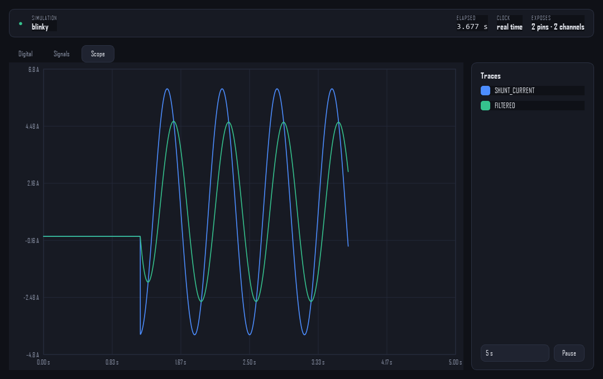
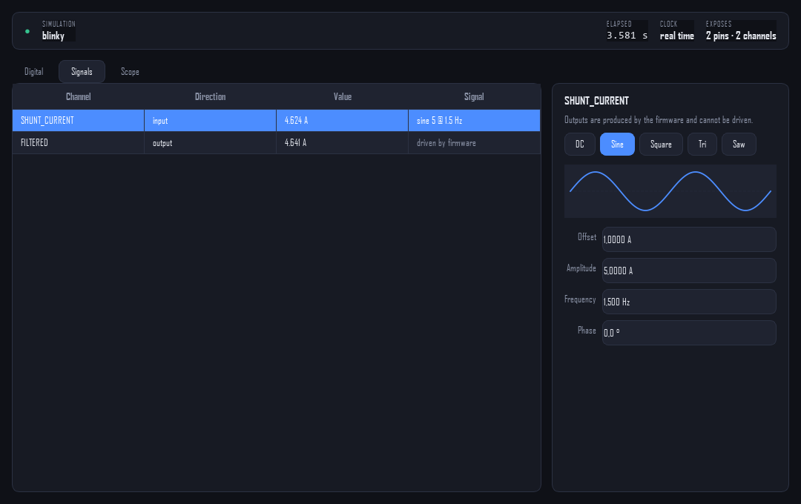

# Signals and the scope

A pin is high or low. A measurement input is a number that moves, and firmware
that measures needs something to measure. Analog channels are that something:
the firmware reads them or writes them, and a client either drives them with a
generated signal or watches what the firmware produced.


## A channel with nothing in it

A channel the firmware registered but never published reads **`no data`**
rather than zero:

```text
  0 P1A      output  0 A
  2 POWER    output  no data
```

The two look the same on a plot and mean entirely different things. `P1A`
is publishing and happens to be zero; `POWER` has never published at all,
which almost always means the calculation behind it is switched off in the
firmware's own configuration rather than that anything is miswired. See
[Analysing a firmware](analysing.md#why-is-nothing-there).

## Channels

The firmware registers each channel once at start up, the same way it registers
pins:

```c
looper_analog_register(0u, "SHUNT_CURRENT", "A", LOOPER_CHANNEL_DIRECTION_INPUT);
looper_analog_register(1u, "POWER",         "W", LOOPER_CHANNEL_DIRECTION_OUTPUT);
```

Direction decides who writes. An **input** is driven by a client and read by
the firmware; an **output** is produced by the firmware and only watched. A
client that tries to drive an output is refused, the same way it is refused on
a digital output.

The device model routes the adapter onto them:

```c
static double model_measure(uint32_t channel)
{
    return looper_analog_read(channel);
}

static void model_publish(uint32_t channel, double value)
{
    looper_analog_write(channel, value);
}
```

## The generator

A signal is a definition, not a stream of samples:

| Field | Meaning |
| --- | --- |
| `waveform` | `constant` (DC), `sine`, `square`, `triangle`, `sawtooth` |
| `offset` | the level the signal is centred on |
| `amplitude` | peak deviation from the offset |
| `frequency_hz` | repetitions per second |
| `phase_degrees` | shift within one period |

`constant` uses the offset alone, which is how a DC level is expressed. Every
other waveform swings by the amplitude around the offset, so a sine with
offset 1 and amplitude 5 runs between -4 and 6.

```python
from looper.domain.model.simulation import SignalDefinition, Waveform
from looper.infrastructure.ipc import ProtobufSimulationSession

with ProtobufSimulationSession(port=45771) as session:
    shunt = next(c for c in session.read_analog_channels() if c.is_drivable_by_client)
    session.set_signal(
        shunt.identifier,
        SignalDefinition(waveform=Waveform.SINE, amplitude=5.0, offset=1.0, frequency_hz=2.0),
    )
```

### Why the definition and not the samples

A client could send samples instead. It would send them as fast as it polls,
and the firmware would see a staircase at the client's rate rather than a
signal at its own.

So the definition is installed once and **the simulation evaluates it on every
firmware read**, against the simulated clock. A firmware sampling at 1 kHz sees
a 1 kHz signal whether the client polls ten times a second or once a minute.
`looper_analog_evaluate` is the whole of it, and the inspector's preview uses
the same formula so that what is drawn is what the firmware will get.

## The trace

Every read and every write is recorded with the time it happened:

```c
looper_trace_record(channel, value);   /* called by looper_analog_read/write */
```

The recording therefore has the resolution of the firmware, not of the client.
A client reads it incrementally: it remembers the sequence number it last saw
and asks for what came after.

```python
samples, cursor = session.read_trace(0)
more, cursor = session.read_trace(cursor)
```

The trace holds `LOOPER_TRACE_CAPACITY` samples (4096 by default) and drops the
oldest. At 1 kHz across two channels that is about two seconds of history in
the simulation; the inspector keeps its own longer window on the client side.

## The scope

The inspector draws the trace against simulated time.



Blue is an input driven with a sine. Green is what the firmware computed from
it: visibly attenuated and lagging, because the firmware runs a first order
filter over it. That difference is the thing worth seeing, and it is the reason
the trace records at firmware rate rather than at poll rate.

The controls are deliberately few:

- **Tick boxes** choose which channels are drawn. The box carries the trace
  colour, so the legend says both which colour a channel has and whether it is
  shown without repeating itself in two controls.
- **The time window** is 1, 5, 10 or 30 seconds. Points outside it are dropped.
- **Pause** stops collecting, so a moment can be read off without it scrolling
  away.

The value axis scales to what is visible and is padded slightly, so a trace
never sits exactly on the frame.

## The editor



The channel list is on the left, the editor on the right. Choosing a waveform
disables the fields that waveform does not use: a DC level has no amplitude,
frequency or phase, and showing live fields that do nothing is worse than
showing disabled ones.

Edits apply immediately rather than behind an apply button. The firmware is
running, so an edit that has not reached it yet is a lie the window is telling,
and the preview already shows what is about to happen.

The editor reloads from the simulation only when the selection moves. Reloading
it on every poll would fight whoever is typing in it.
